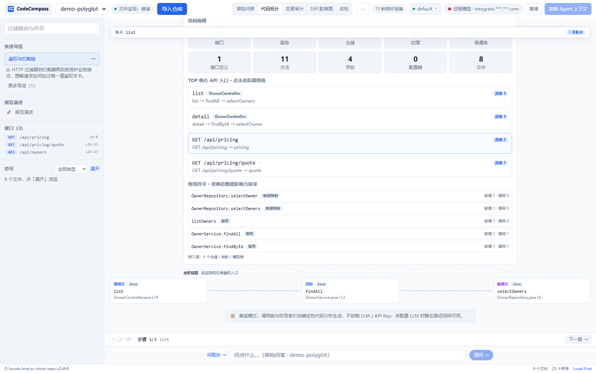
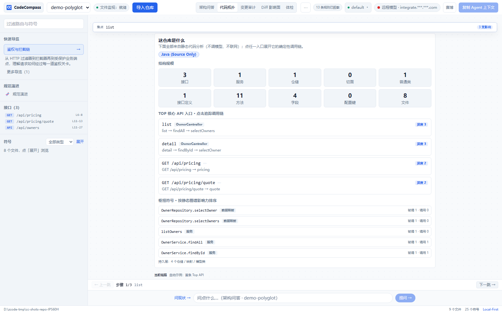
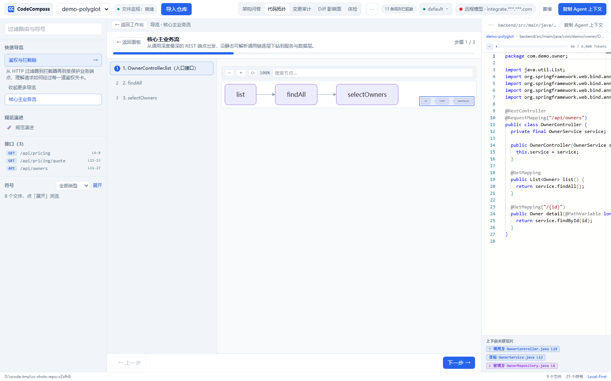
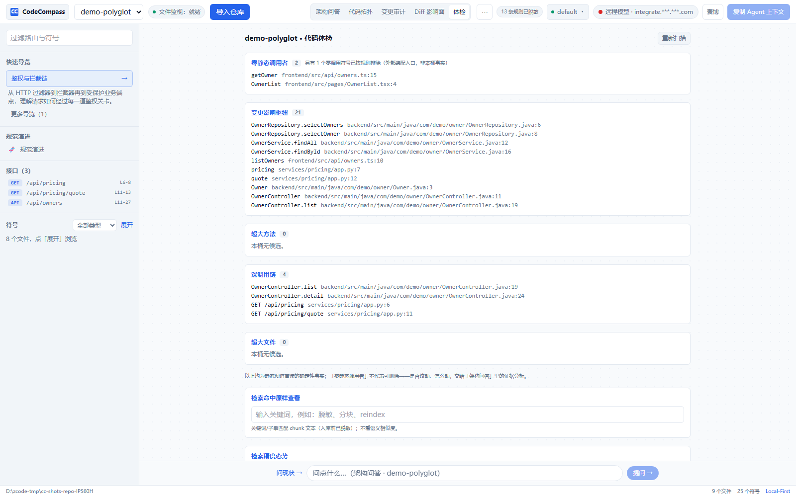
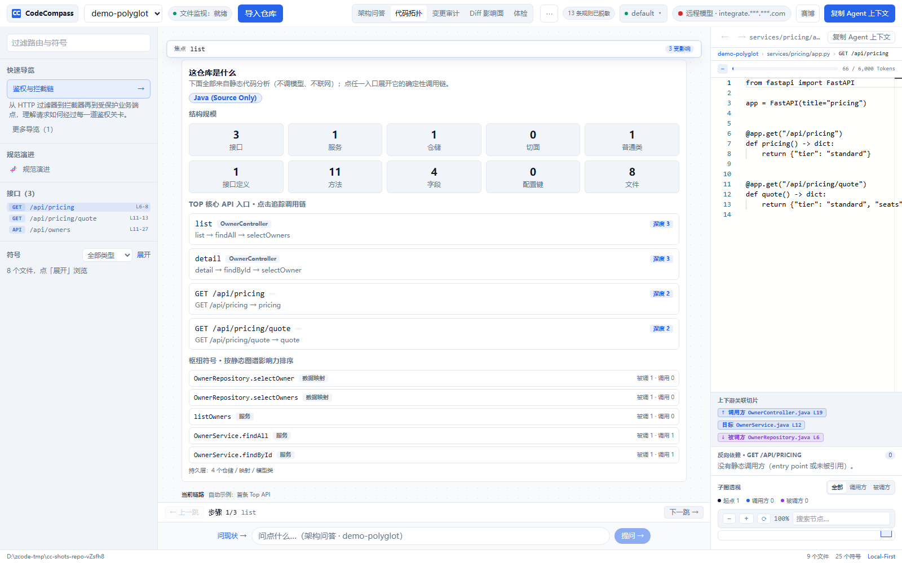
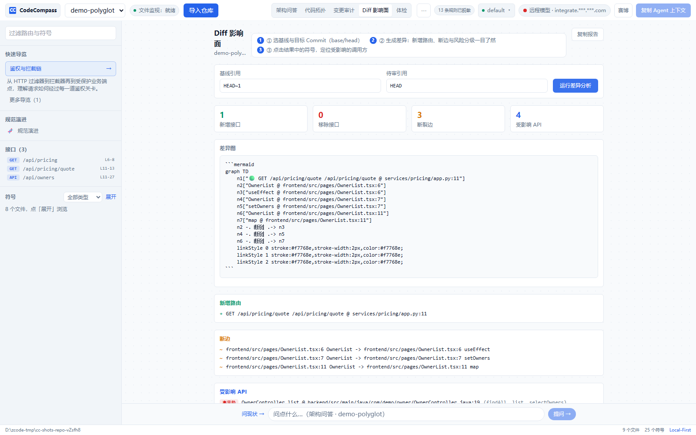
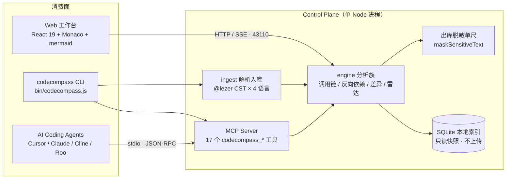

<div align="center">

# 🧭 CodeCompass

**大模型分析代码时经常把同名方法混在一起；我们用 TypeScript / Java 语法树在索引期把真实的调用关系定死，每个结论都带可点击的 `file:line`。**

本地优先的**多语言代码事实层**：确定性调用链、跨栈根因穿透、架构影响面，经 Model Context Protocol (MCP) 直达 coding agent。对源码只读、零 LLM 依赖——推理交给 LLM，「代码到底怎么连的」这种事实查询交给确定性引擎，两者不互相冒充。

> **产品面（唯一权威，ADR-0021）**：**MCP 17 工具 + CLI 是对外承诺面**；Web 工作台是维护者自己的 **dogfooding 驾驶舱与演示面**（内部工具，不是并列的第二产品，不作为对外承诺）。新想法只有两条通道：增强事实面并说清降低哪类误报/提升哪类精度，或改驾驶舱并说清维护者日常怎么用——都答不上来就不做。

[](https://github.com/shing26/CodeCompass/releases/tag/v1.8.0)
[](https://github.com/shing26/CodeCompass/actions/workflows/ci.yml)
[](https://nodejs.org/)
[](https://www.typescriptlang.org/)
[](https://react.dev/)
[](https://modelcontextprotocol.io/)
[](#adr)
[](#quality)
[](https://www.npmjs.com/package/@codecompass/cli)
[](./LICENSE)

[为什么](#why) • [产品一览](#gallery) • [核心特性](#features) • [已知限制](#limitations) • [快速上手](#quickstart) • [MCP 接入](#mcp) • [架构治理](#adr) • [质量门禁](#quality) • [路线图](#roadmap)

</div>

---

<a id="gallery"></a>

## 📸 产品一览

> 全部为本机**真实渲染**（非示意图）：演示 fixture 为 Java Spring + TypeScript + Python 混合仓（两次提交）。UI 变更后用 `node scripts/smoke/readme-shots.mjs` 重新生成。

**确定性调用链**——点任一入口展开全链，逐跳 `file:line` 锚点，步骤条逐跳导航，断链显式标记：



<table>
  <tr>
    <td align="center" width="50%"><br><sub><b>拓扑概览</b>：栈构成 / 结构规模 / 枢纽符号 / Top API 入口</sub></td>
    <td align="center" width="50%"><br><sub><b>Onboarding Tour</b>：mermaid 渲染主业务流全链，节点绑定 <code>code://</code> 深链</sub></td>
  </tr>
  <tr>
    <td align="center"><br><sub><b>体检</b>：五桶候选 + 精度态势，只报确定性事实、判断留给使用者</sub></td>
    <td align="center"><br><sub><b>Inspector</b>：Monaco 只读源码 + 上下游关联切片 + 子图缩略图</sub></td>
  </tr>
</table>

**Diff 影响面**——基线到 HEAD 的架构差异：新增接口 / 移除符号 / 断边 / 受影响 API 分级，差异图以 mermaid 渲染（红边 = 静态断链）：



---

<a id="why"></a>

## 💡 为什么需要 CodeCompass？

让 coding agent（Claude Code、Cursor、Cline……）读大型代码库时，有两个绕不开的死结：

- **上下文爆炸**：把整个仓库塞进上下文窗口，成本陡增，噪音淹没信号；
- **更隐蔽的那个——编造**：LLM 会凭函数名的相似性"脑补"调用链，架构判断建立在虚构的边上，而且**读起来总是很像真的**。

CodeCompass 的立场是「**精确检索工具，不是理解工具**」：把 agent 不擅长的大规模确定性查找（全库反向依赖、调用链、影响面、规模统计）做到秒级精确，把省下来的上下文窗口留给 agent 去精读真正该读的文件。仓库越大价值越大；架构判断、设计评审、安全隐患排查仍属于 agent 的读码工作，引擎不越界。

而「不编造」首先是引擎对自己的纪律。v1.3.0 收口批次的主题就是「**让工具停止编造**」——起因是一次双路走查发现：**58/64 个路由入口返回同一条常量调用链，还打着 VERIFIED 徽章**。修复不是加更多提示词，而是删掉那个"取全仓第一个方法符号"的兜底：**无起点即无链路**，diagnose 如实报 SUSPECT。

| 维度 | 让 LLM 直接推断 | grep / 正则扫描 | CodeCompass |
| :--- | :--- | :--- | :--- |
| **调用链拓扑** | ⚠️ 凭名称相似脑补，虚构边 | ⚠️ 文本匹配，无符号语义 | ✅ 编译期语法树逐边求解（`@lezer` CST），同一份代码永远得到同一张图 |
| **断链处理** | ❌ 静默补全 | ❌ 无概念 | ✅ 显式标记 **Static Analysis Break**，缺层不硬凑 |
| **跨语言穿透** | ⚠️ 单文件视角 | ❌ 单语言 | ✅ 前端 `fetch`/`axios` → Spring / Express / Gin / Fiber / FastAPI / Flask 路由连边；Prisma 数据层穿透 |
| **Agent 接口** | ❌ 纯文本 | ❌ 无标准协议 | ✅ 17 个 `codecompass_*` MCP 工具（stdio，零 LLM） |
| **隐私边界** | ⚠️ 全量上送 | — | ✅ 双层脱敏：索引层只落 key，出库前 `maskSensitiveText` 单尺过滤 |
| **证据形态** | ❌ 无锚点 | ⚠️ 裸行号 | ✅ 物理锚点 `repoId + commit + file:line`，raw file 校验通过才展示 |

---

<a id="features"></a>

## ✨ 核心特性

### 1. 确定性 AST 调用链

基于 `@lezer` 语法树（CST）构建调用图：不调用任何 LLM、不消耗 token、结果可复现。代码拓扑视图以聚焦卡片流 + 调用链步骤条呈现，逐跳直达 `file:line` 源码锚点；Onboarding Tour、演进工件与 Diff 差异图以 mermaid 渲染图谱，节点绑定 `code://file#line` 深链。静态解析不到的位置显式标记 **Static Analysis Break**（链路止于仓库外时为 EXTERNAL——是分析边界，不是缺陷），绝不静默编造。链路追踪 100% 确定性（ADR-0005）；问答侧另有「零幻觉合约」兜底——每条断言逐字来自工具返回的 Call Edge，每个 `file:line` 必须过 raw-file 物理校验。

### 2. 多语言适配器

`LanguageAdapter` 抽象层把不同语言的语法树统一成同一套 `RepoSymbol` 契约——同一份索引、同一套算法、同一个 Web / MCP / CLI 证据面：

| 语言 | 扩展名 | 框架 / 路由识别 |
| --- | --- | --- |
| Java | `.java` | Spring MVC 注解、MyBatis Mapper（含 XML SQL 穿透） |
| TypeScript / JavaScript | `.ts` `.tsx` `.js` `.jsx` `.mjs` | NestJS 装饰器、Express 路由、`axios` / `fetch` 调用点 |
| Go | `.go` | Gin / Fiber 路由注册、`net/http` 标准库入口 |
| Python | `.py` | FastAPI / Flask 装饰器、`pyproject.toml` / `.env` 配置证据 |

### 3. 跨语言契约桥接与数据层穿透

前端 HTTP 调用点（`fetch` / `$fetch` / `axios`，含 `axios.create` 封装）按归一化路径**唯一匹配**到后端路由后连边，前端到后端的调用链在同一张图里打通——候选不唯一时停下并标记，而不是猜。TS/Node.js 工程的 `schema.prisma` 解析为实体与操作符号，`prisma.post.findMany()` 类调用确定性解析到数据层。

### 4. 专精 Agent 的复合工具

两大确定性、零 LLM 复合工具替代分散的单点查询：

- **根因穿透** `codecompass_diagnose`：从方法名或 `"POST /api/owners"` 出发，穿透 前端组件 → 路由 → Service → Mapper/XML SQL，逐层标 `VERIFIED / BROKEN / SUSPECT`，缺层不硬凑；
- **爆炸半径** `codecompass_refactor_plan`：递归聚合直接/间接调用方，上卷受波及对外路由与桥接前端组件，给出 HIGH/MEDIUM/LOW 风险评级与迁移步骤。

配套还有：`codecompass_plan_evolution`（EXTEND 挂载点分析 / DEPRECATE 固定点级联孤立死代码）、`codecompass_domain_radar`（出入度 + 确定性 PageRank，零 embedding）、`codecompass_scan`（五桶"该动哪里"自荐，只报确定性事实、判断留给 agent）、`codecompass export`（单文件自包含 HTML 诊断工件，内联 mermaid 运行时，断网可渲染、可随 PR 归档）。

### 5. Graph RAG Agent Context

`codecompass context <query>` 用与调用链完全一致的确定性入口解析器定位符号，沿内存符号图做 **1-Hop Caller + 1~3 Hop Callee** 双向检索：折叠类骨架、按优先级队列做 Token 预算剪枝、14 类凭据脱敏，产出可直接粘贴给 Agent 的 Markdown。

### 6. Local-First 隐私与脱敏

- **索引层**：配置只索引 key，value 从不落盘、从不导出；多模式确定性掩码引擎只重写凭据类字面量赋值；
- **输出层**：所有导出与 HTTP 响应再经 `maskSensitiveText` 防御性过滤（14-pattern 唯一权威尺，双保险）；
- **前端可见**：隐私药丸三态（纯本地 / 本地模型 / 远程模型）、会话 Token 预算、消息级来源徽章——远程 LLM 问答默认关闭，需显式同意。

#### 模型档位（`llm-profiles.json`，可选）

默认只有 `default` 一档（直接读 `.env` 里的 `REPOQA_LLM_*`）。要多档热切换，在数据目录（默认 `~/.mhw`，可用 `--data-dir` / `MHW_DATA_DIR` 改）放一个 `llm-profiles.json`：

```json
{
  "profiles": [
    { "name": "default" },
    {
      "name": "remote-openai-compatible",
      "baseUrl": "https://api.example.com/v1",
      "model": "your-model-name",
      "apiKeyEnv": "REPOQA_LLM_API_KEY"
    }
  ]
}
```

- 字段：`name`（必填）、`baseUrl`（OpenAI 兼容端点，自动补 `/chat/completions`）或 `url`（完整端点，优先）、`model`、`apiKeyEnv`（**只写环境变量名，不写密钥本身**）；
- 未在文件里出现 `default` 时会自动补上；`baseUrl` / `model` / key 缺省时回落到同名 `REPOQA_LLM_*` / `COPILOT_LLM_*` 环境变量；
- 完整示例见 [`docs/llm-profiles.example.json`](docs/llm-profiles.example.json)；
- 切换在顶栏模型胶囊完成，**热切换不重启进程、不断连接**，每次切换写入会话日志。

### 7. 韧性与自诊断

`codecompass doctor --json` 一键体检（Node 版本、SQLite 原生 ABI、端口、数据目录与磁盘余量、本地 Ollama）；DISCOVERY → AST_EXTRACTION → CROSS_LANG_BRIDGE → FINALIZING 四阶段实时进度；FS watcher 热重载，编辑即所见；超大文件自动降级轻量提取，不拖垮索引；启动前自动备份 SQLite（保留最近 5 份）。

### 8. Zero-Config 安装器

```bash
codecompass install --ide <cursor|zcode|claude|windsurf|cline|roo|all>
```

把 stdio MCP 入口写进各 IDE 自有配置（Cursor `~/.cursor/mcp.json` 并注入 autoApprove 白名单、ZCode、Claude Desktop 等 6 家），自动解析 Node 运行时绝对路径，幂等合并、写前自动备份。**默认不自动批准破坏性工具**——`codecompass_remove_repo`（级联删除索引数据）不在白名单，需要时显式加 `--auto-approve-all`。

---

<a id="architecture"></a>

## 🏗️ 系统架构



> **双面体原则（ADR-0020）**：MCP 面是产品面（给 IDE / agent 宿主用，17 工具签名与数量冻结），Web 工作台是维护者日常驾驶舱与演示调试面——两端消费同一份引擎输出，不另起叙述管线。引擎对源码**只读**、永不写回（ADR-0001）。术语表见 [`CONTEXT.md`](./CONTEXT.md)。

---

<a id="limitations"></a>

## ⚠️ 已知限制（Known Limitations）

先把不行的说清楚，再说行的——以下每一条都是当前版本的事实，可以对到 ADR 或实测记录：

1. **只解析静态显式调用。** 运行时 `eval`、`apply` / `call` 动态绑定、反射、依赖注入容器在运行时组装的对象、消息总线，都不在射程内。调用链走到这些位置会**显式停下并标记**（`EXTERNAL` / `DYNAMIC` / `UNRESOLVED`）——这是分析边界，不是链路错误；引擎不会猜测断点之后是什么（ADR-0002、ADR-0005）。
2. **TS/JS 只解析相对路径 import（L1），别名与包名互引仍是边界。** v1.6 起索引期构建模块消解表：跨文件调用优先按 `./x`、`../y` 这类**相对 import 声明**绑定，同一个名字在多文件声明时不再静默绑「最早声明」，无法唯一确定的边标「存疑」而不是猜。仍未覆盖：tsconfig 的 `baseUrl` / `paths` 别名（L2）与包名互引的 monorepo workspaces（L3）——`@/foo` 这类别名**不会报错**，只是不参与消解。触发线与后续登记在 `.scratch/v1.4-usable-tool/issues/08-deferred-ts-module-resolution.md`。
3. **Go 接口的隐式实现保持 `dynamic`。** Go 没有 `implements` 关键字，方法集推断尚未参与消解，这部分边按设计保持动态、不伪造（ADR-0018）。
4. **检索是关键词 / 子串匹配，不是语义检索。** 没有 embedding、没有向量库（ADR-0002 的翻案门槛从未被证据触发）；自然语言提问靠符号名与配置 key 锚定，措辞越接近代码里的标识符，命中越好。
5. **运行时行为不在射程内。** 不接 APM / 日志流，不做线上定位（ADR-0011）：它回答「代码是怎么连的」，不回答「线上为什么慢」。
6. **环境约束**：Node >= 24 是硬约束（`better-sqlite3` 原生模块 ABI）；控制面无鉴权，默认只监听 `127.0.0.1`；早前装过 IDE 的环境需要重跑一次 `codecompass install` 刷新工具允许列表。
7. **工件浏览器门只验「能不能用」，不验「对不对」。** release 门用真 Chromium 打开导出的单文件 HTML，检查可渲染 / 可交互 / 无运行时错误 / 无外部依赖（ADR-0023）；工件正文的语义正确性（锚点是否真实、结论是否成立）不在这道门的射程内——那由引擎测试与 MCP `verification` 回执负责。

---

<a id="quickstart"></a>

## 🚀 快速上手

### 前置要求

- **Node.js >= 24**（`engines` 硬约束，`codecompass doctor` 同约束）：`better-sqlite3` 是原生模块，本地直接运行 `dist` 时 Node 主版本必须与构建时 ABI（NODE_MODULE_VERSION）匹配；Docker 路径在镜像内重新 `npm ci` 重建原生模块，不受此限
- 首次使用需要构建一次（`bin/codecompass.js` 依赖 `dist/` 产物）

### 30 秒先看看效果（零配置，不需要先找到仓库路径）

- **Web**：`npm run dev` 打开工作台 → 空状态点「**载入示例项目（一键）**」——内置一个很小的任务看板 API 源码，索引完自动弹出首条调用链；或点「**粘贴一段代码看看**」，把一段 TS/JS 直接贴进去，立刻看到它内部的调用关系（服务端内存解析：不落盘、不入库）。
- **CLI**：`node bin/codecompass.js trace <符号名> /path/to/repo` 直接在终端打出该符号的上游 / 下游调用树。

### 方式一：CLI（推荐）

```bash
# 1. 安装全部 workspace 依赖
npm run install:all

# 2. 构建（一次即可，产物在 dist/）
npm run build

# 3. 单命令导入并打开驾驶舱
codecompass /path/to/your/repo
# 或不全局安装：
npm start -- /path/to/your/repo
```

常用命令：

```bash
codecompass <path> --port 9000        # 自定义端口（默认 43110 / $MHW_CP_PORT）
codecompass <path> --data-dir ./data  # 自定义数据目录（默认 ~/.mhw / $MHW_DATA_DIR）
codecompass <path> --no-browser       # 只启动服务，不自动开浏览器
codecompass trace login [path]        # 终端调用树：谁调它 / 它调谁（--up/--down 调层数）
codecompass trace ./src/auth.ts -f login [path]   # 按文件 + 函数名定位后追链
codecompass context listOrders [path] # 导出 Graph RAG Agent 上下文
codecompass diagnose "POST /api/owners" [path]    # 跨栈根因穿透（JSON，CI 可消费）
codecompass export login [path] --output report.html  # 单文件自包含 HTML（--file 同义）
codecompass diff <base> <head> [path] # PR 架构影响面（支持 --fail-on-auth-impact）
codecompass doctor --json             # 环境自诊断
```

### Web 工作台（驾驶舱与调试面）

```bash
npm run dev   # vite dev server → http://localhost:5173（API 走 43110）
```

三栏布局（clean / cyber 双主题）：左侧 Quick Tours 导览、路由列表与符号树；中央提问即得确定性调用链时序图，一级导航为 chat / 代码拓扑 / 变更审计 / Diff 影响面 / 体检五项（架构仪表盘与规范演进降入 ⋯ 更多操作与左侧栏入口，v1.2.x R4-13）；右侧 Inspector 为 Monaco 只读源码 + 反向依赖 / 子图透视。服务默认只监听 `127.0.0.1`（控制面无鉴权）；确需他机访问时设 `MHW_CP_HOST=0.0.0.0`，启动日志会打印 LAN 暴露告警。

### 方式二：Docker（容器开发）

```bash
docker compose up --build
```

`docker-compose.yml` 将当前目录**只读挂载**到容器内 `/repo`（容器拿不到源码写权限），导入结果存命名卷 `codecompass-data`，服务暴露在 `http://localhost:43110`。

### 数据与备份

- **删除仓库**：只移除仓库索引，源文件与本地克隆目录保留，之后可随时重新导入同一路径；
- **启动前自动备份**：每次启动服务前用 SQLite online backup 生成 `mhw.db.backup-<时间戳>`，数据目录保留最近 5 份。

---

<a id="mcp"></a>

## 🔌 接入 MCP 生态

CodeCompass 原生支持 **Model Context Protocol**（stdio / JSON-RPC），可作为 MCP Server 直接注入主流 AI 开发工具。工具面是产品面——签名与数量冻结，新增须附精度论证（ADR-0020 双轨制纪律）：

<!-- mcp-tools:begin -->
`codecompass mcp <path>` 启动标准 stdio MCP 服务，当前提供 **17 个**确定性工具（全部零 LLM、结果确定性可复现）：

| 工具 | 用途 |
| --- | --- |
| `codecompass_list_repos` | 列出已索引仓库（id / status / fileCount / symbolCount / error 根因） |
| `codecompass_trace_call_chain` | 解析确定性静态调用链 |
| `codecompass_get_dashboard` | 聚合零 Prompt 架构驾驶舱 |
| `codecompass_get_config_evidence` | 配置 key 证据（只返回 file:line，不返回 value） |
| `codecompass_get_tours` | 返回 Onboarding Tour |
| `codecompass_reverse_deps` | who-uses 反向调用者查询 |
| `codecompass_get_pr_impact` | Git PR 架构影响面分析 |
| `codecompass_get_subgraph_context` | **Graph RAG 子图提取**：上游 1 层调用方 + 下游 1~3 层被调方、骨架折叠、Token 剪枝与凭据脱敏 |
| `codecompass_domain_radar` | **领域全景雷达**：出入度 + 确定性 PageRank 的 Hub 节点、Top APIs、持久化底座与意图锚点（零 embedding） |
| `codecompass_module_evolution` | **已弃用（deprecated）**——由 `codecompass_plan_evolution` 接替；保留仅为向后兼容 |
| `codecompass_diagnose` | **跨栈根因穿透**：前端组件 → 路由 → Service → Mapper 分层链路，逐层 VERIFIED/BROKEN/SUSPECT |
| `codecompass_refactor_plan` | **重构爆炸半径**：直接/间接调用方、受影响路由与前端组件、风险评级与迁移步骤 |
| `codecompass_index_repo` | **索引入口**：克隆 GitHub 仓库或索引本地目录；异步契约——立即返回 `indexing`，轮询 `list_repos` 至 ready/error（ADR-0016） |
| `codecompass_remove_repo` | 移除索引（级联清除符号/事件，磁盘保留；indexing 中拒删） |
| `codecompass_scan` | **自荐发现**：五桶候选——零调用者孤儿（ADR-0018 后只含**可调用符号**，类型声明与接口成员按规则排除、计数于 `census.excluded`） / PageRank 热点 / 超长方法 / 深链入口 / 超大文件，每桶带锚点与下一步工具引导 |
| `codecompass_get_conventions` | 约定画像五轴（return_wrapping / interface_impl_style / di_style / naming / async_pattern），邻居优先仲裁 |
| `codecompass_plan_evolution` | **演进方案（`module_evolution` 的接替者）**：EXTEND 挂载点 + 声明级事务边界 + 解耦模式与脚手架；DEPRECATE 固定点级联孤立死代码 + 清理 Checklist（补丁仍归 LLM 层） |
<!-- mcp-tools:end -->

### 接入 Claude Desktop

编辑 `claude_desktop_config.json`（Windows：`%APPDATA%\Claude\claude_desktop_config.json`；macOS：`~/Library/Application Support/Claude/claude_desktop_config.json`）：

```json
{
  "mcpServers": {
    "codecompass": {
      "command": "npx",
      "args": ["-y", "@codecompass/cli", "mcp", "/path/to/your/repo"]
    }
  }
}
```

### 接入 Cursor / Cline / Roo

在项目根目录创建 `.cursor/mcp.json`（Cline / Roo 用各自的 MCP 设置项），内容同上。

### 版本实情（重要）

npm registry 上 `@codecompass/cli` 最新为 **1.8.0**（2026-10-27 发布；chat 流式可感知批，见 CHANGELOG）。上架节奏：0.31.0 → 1.4.0 → 1.5.0 → 1.7.0 → **1.8.0**；**1.4.1 / 1.4.2 / 1.5.1 / 1.6.0 只有 git tag，未单独上架**。本仓库工作树 = npm 上的 1.8.0（`git tag v1.8.0`）。`npx -y @codecompass/cli mcp /path/to/your/repo` 即得全部 17 个工具；若要用比 npm 更新的工作树提交，按上文 clone + `npm run build` 后：

```bash
node bin/codecompass.js mcp /path/to/your/repo
# 或全局链接后使用 codecompass 命令：
npm install -g .
codecompass install --ide all   # 一键写入 6 家 IDE 的 MCP 配置
```

写入 Cursor / Cline / Roo 配置时，`autoApprove` 允许列表**默认不含破坏性工具**（`codecompass_remove_repo`，级联删除索引数据）；需要恢复全量 17 个工具时加 `--auto-approve-all`。**早前装过的环境不会自动变安全**——重跑一次 `codecompass install` 刷新允许列表。

---

<a id="adr"></a>

## 📐 架构治理（ADR）

本项目严格采用架构决策记录指导技术选型与边界演进，仓库内沉淀 **24 份 ADR**（ADR-0001–0024，均为已生效决策）：

| ADR | 核心决策 |
| --- | --- |
| [0001](./docs/adr/0001-repopulse-read-only-local-first.md) | 只读、本地优先（曾用名 RepoPulse，等价 CodeCompass） |
| [0002](./docs/adr/0002-structured-static-analysis-over-semantic-retrieval.md) | 结构化静态分析优于语义检索——真理之源红线 |
| [0003](./docs/adr/0003-security-gates-before-llm.md) | 进 LLM 之前的安全门禁：脱敏先行 |
| [0004](./docs/adr/0004-golden-dataset-before-prompt-tuning.md) | 先黄金数据集，后 prompt 调优 |
| [0005](./docs/adr/0005-composite-tools-stay-deterministic.md) | 复合工具保持确定性（零 LLM、可单测可重放） |
| [0006](./docs/adr/0006-patch-generation-belongs-to-llm-layer.md) | 补丁生成归 LLM 编排层；确定性工具的 `suggestedPatch` 恒空 |
| [0007](./docs/adr/0007-deep-links-on-card-flow-not-graph-canvas.md) | 深链落在卡片流，而非图画布 |
| [0008](./docs/adr/0008-lifecycle-dataflow-await-method-body-evidence.md) | 生命周期数据流：await 方法体证据 |
| [0009](./docs/adr/0009-story-beats-artifact-only.md) | 分步演播只进自包含 HTML 工件 |
| [0010](./docs/adr/0010-physical-anchor-pins-commit.md) | 物理锚点钉住 commit，防行号漂移成幽灵锚点 |
| [0011](./docs/adr/0011-incident-copilot-static-boundary.md) | 排障副驾驶的静态边界（不接 APM / 日志流） |
| [0012](./docs/adr/0012-copilot-positioning-intent-artifact.md) | copilot 定位：意图 → 单次高密度工件 |
| [0013](./docs/adr/0013-diagram-geometry-rendered-by-engine.md) | 图谱几何由确定性引擎渲染，LLM 只产图层指令 |
| [0014](./docs/adr/0014-pattern-ingestion-evidence-anchored.md) | 模式摄取必须带证据锚点 |
| [0015](./docs/adr/0015-evolution-workbench-freeform-intent.md) | 演进工作台：自由意图入口 |
| [0016](./docs/adr/0016-mcp-long-ops-return-immediately.md) | MCP 长操作立即返回 + 轮询（含幽灵索引防线） |
| [0017](./docs/adr/0017-gate-run-history-server-side.md) | 门禁运行史服务端化，而非 CI 遥测 |
| [0018](./docs/adr/0018-orphan-bucket-semantics.md) | 孤儿桶只声称「可调用符号的零静态调用者」 |
| [0019](./docs/adr/0019-mcp-audit-log-policy.md) | MCP 审计日志记录入参出参，与 HTTP sink 政策分工 |
| [0020](./docs/adr/0020-web-workbench-revival.md) | Web 工作台再产品化——双面体再平衡 |
| [0021](./docs/adr/0021-mcp-cli-is-the-only-public-surface.md) | MCP/CLI 是唯一对外产品面，Web 为维护者驾驶舱 |
| [0022](./docs/adr/0022-ts-module-resolution-semantics.md) | TS/JS 模块路径消解：只认代码自己的声明 |
| [0023](./docs/adr/0023-artifact-browser-gate-boundary.md) | 工件浏览器验收：只回答「能不能用」，不冒充「对不对」 |
| [0024](./docs/adr/0024-chat-progress-contract.md) | chat 进度契约：让服务端在干嘛可见，但不替用户做决定 |

完整决策列表见 [`docs/adr/`](./docs/adr/)，术语表见 [`CONTEXT.md`](./CONTEXT.md)。

---

<a id="quality"></a>

## 🧪 工程质量与测试门禁

```text
测试套件（vitest，Node 24 本机实跑）：
  services/control-plane     907 tests / 72 files
  apps/repoqa-web            441 tests / 41 files
  packages/bridge-adapters    26 tests /  1 file
  合计                      1374 tests / 114 files（测试与源码同位放置）
```

- **确定性断言**：针对「伪造调用链」测试集设立回归锁定，确保已知模式无漏判、无误判；
- **e2e 门禁**：`python scripts/e2e/closeout_gate.py`，**74 项断言**（v1.8.0 基线 74/0）——覆盖多语言 fixture、跨语言桥接、SSE 流、ADR-0003 脱敏门禁、MCP stdio 复合工具往返、CLI diagnose / refactor-plan / export、install --dry-run、golden eval 阈值冒烟，以及版本四处一致性与 MCP 握手版本棘轮；
- **UI 冒烟**：`scripts/smoke/ui_smoke.mjs`，真 Chromium 六动线走查（含「服务端进度行出现」断言，ADR-0024）；
- **工件浏览器门**：`scripts/smoke/artifact_browser_check.mjs`，release 门用真 Chromium 打开导出的单文件 HTML 工件（9 条检查 + 旁车回执，ADR-0023）；`--self-test` 用三份坏工件验门本身有效；
- **精度工程**：`npm run precision` 对 self / lazygit / petclinic 三仓孤儿数一条命令复跑，`--ratchet` 冻结基线棘轮；基准报表见 [`docs/benchmark.md`](./docs/benchmark.md)；
- **CI**：`ci.yml`（typecheck + 单测 + e2e gate）、`release.yml`、`architecture-diff.yml`；v1.4.0 tag 已推（`9488758`，CI / Release 双绿）。

> **本机实跑备注**：上表为收集总数。在负载异常的机器上（如系统盘将满、换页严重），个别 5s/15s 超时类用例会瞬时失败（git daemon 拉起、eval harness、incident 传输），失败集随负载浮动、复跑可绿——权威基线以 CI 与 v1.8.0 收口门禁（控制面 907 / web 441 / bridge 26、e2e 74/0，见 `CHANGELOG.md` 与 `HANDOFF.md`）为准。

运行全量测试：

```bash
npm test            # 后端 vitest（services/control-plane）
npm run test:web    # 前端 vitest（apps/repoqa-web）
npm run test:bridge # 协议适配层 vitest
npm run e2e         # Python 端到端门禁（需先 npm run build）
```

> Windows 环境注意：跑测试前先把 `TMPDIR` 设到非系统盘——C 盘满会以 ENOSPC 伪装成测试失败（本机实测教训）。

---

<a id="roadmap"></a>

## 🛣️ 路线图

- [x] **v1.0.0**：17 工具 v1 契约冻结 + 精度边界技术文章（`docs/article-v1-precision-boundary.md`）
- [x] **v1.1.0**：检索取证与证据诚实（FTS5(trigram) 双路径检索、真仓 top-10 假阳性门）
- [x] **v1.2.0**：工作台产品化（ADR-0020 双面体再平衡：五面驾驶舱、导入 202 + WS 流式进度）
- [x] **v1.3.0（tag `e31ea8e`）**：「让工具停止编造」——伪造调用链红线修复、`EXTERNAL` 语义、未解析指标去灌水（TS/JS 38%→0%）、僵尸索引每分钟对账回收
- [x] **v1.4.0**：上手与可用性手术——示例项目一键载入、片段粘贴即出调用图、子图焦点模式、`codecompass trace`、README 已知限制章节
- [x] **v1.4.1**：定位定稿（ADR-0021：MCP/CLI 唯一对外产品面，Web 为维护者驾驶舱）——清理 Lifecycle/Dataflow 禁用占位、Web incident 死链；MHW harness 面冻结标注
- [x] **v1.4.2**：对账批收尾——Java 裸映射注解（无参数）计为 HTTP 入口；Top API 空榜确定性说明；`llm-profiles.json` 示例与用法
- [x] **npm 发布**：`@codecompass/cli@1.8.0` 已上架（2026-10-27；此前 1.7.0 @ 2026-10-27、1.5.0 @ 2026-10-25、1.4.0 @ 2026-10-19）；1.4.1 / 1.4.2 / 1.5.1 / 1.6.0 **未上架**（只有 git tag）
- [x] **R5-08 / R5-09 / R5-11 / R5-14 / R5-16（2026-10-19 盘点销项）**：模型多档热切换已实现（默认只带 `default`，用户可自建 `~/.mhw/llm-profiles.json`）；授权后不自动发送=设计取舍并已有草稿提示；恒定焦点计数已删除；流式中断（停止键 / Esc）已落地；长回答折叠已实现（阈值 2400 字）
- [x] **R5-05（v1.8.0 收口）**：chat 流式服务端进度与慢模型断点提示——`progress`/`hint`/`heartbeat` 三事件（ADR-0024）+ ChatView 进度行/慢提示 + CLI REPL 进度；实测慢首字 20.4s 静默 → 5.0s 心跳保底、15s 慢提示
- [x] **v1.5.0**：交付也可验证——MCP 返回体 `verification` 回执（锚点存在性 + 断链标记 + 带路径 diagnostics，17 工具签名零变化）；export HTML 重放校验入口；R5-13 无链路兜底文案收尾；TS/JS 模块解析探针（self 仓 3274 条同名歧义边中 1301 条可被 import 解析唯一钉死，数字进 v1.4 票 08 触发线判定）
- [x] **v1.5.1**：回执读数修正——断链标记接回 trace 断口的线上真形态（此前 `breakMarkers` 恒空）；锚点校验从「只认文件」升级到「文件 + 行号物理校验」；超 500 条锚点的截断与无仓库根的跳过都进 diagnostics，不再静默
- [x] **v1.6.0**：TS/JS 模块路径消解（L1）——索引期模块表 + import 钉死跨文件绑定；多文件同名且钉不住的边标「存疑」而非猜绑定（self 仓实测：246 条歧义边 = 230 标存疑 + 16 救回，0 回退；Go/Java 读数逐字节不变）
- [x] **v1.7.0**：工件交付也可验证——真 Chromium 工件门（9 条 fail-closed 检查）+ 旁车回执（三态退出码，UNCHECKED 不算绿）+ release 接线（Release 资产含工件 + `browser-check.json` 回执，CI 真跑）；`data-check` 钩子；工件元数据版本串收口（ADR-0023）
- [x] **v1.8.0（当前版本）**：chat 流式可感知——服务端 `progress`/`hint`/`heartbeat`（5s 心跳、15s/45s 慢提示、180s 硬超时）+ ChatView 进度行/慢提示 + CLI REPL 进度（ADR-0024）；R5-05 销项

当前版本：`v1.8.0`（版本单一源 `services/control-plane/src/version.ts`；CHANGELOG 含 0.5.x–1.8.0 完整条目）。

---

## 📄 开源许可证

本项目基于 [MIT License](./LICENSE) 协议开源。

---

## 目录结构

```
apps/repoqa-web/            # React 三栏工作台（驾驶舱与演示调试面）
services/control-plane/     # 单进程控制面：解析、索引、调用链、桥接、脱敏、导出
packages/contracts/         # 前后端共享契约（错误码单一源、文案共表）
packages/bridge-adapters/   # 协议适配层
scripts/e2e/                # API 级回归门禁（closeout_gate.py）
scripts/smoke/              # README 截图生成器 + UI 冒烟（ui_smoke.mjs）
.github/assets/             # README 截图资产（readme-shots.mjs 生成）
bin/codecompass.js          # CLI 启动器（thin launcher）
docs/adr/                   # 架构决策记录；术语表见 CONTEXT.md
docker-compose.yml          # 本地容器开发（只读挂载）
```

<!-- 视觉资产：.github/assets/*.png 由 scripts/smoke/readme-shots.mjs 生成
     （真 Chromium + 演示 fixture）；UI 大改后重跑刷新，勿手改图片。 -->
